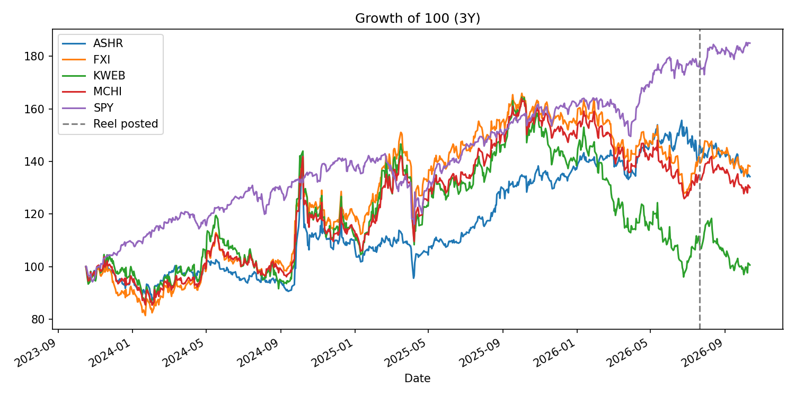

# Case Study: The "Buy Chinese Stocks Now" Thesis (2025–2026)

> **Educational research only, not investment advice.** I am not a licensed financial advisor. Data points come from public sources dated as noted below. Check live quotes before drawing any conclusions.

## 1. Background

In July 2026 a Spanish-language finance reel (@isracrypto.eth, roughly 12K likes) asked *"¿Hora de invertir en acciones chinas?"* ("Is it time to invest in Chinese stocks?"). Its argument had three parts:

1. Chinese equities trade at low valuations compared with the S&P 500, which it described as expensive and compared with the dot-com era.
2. Chinese property prices have fallen back to roughly 2005 levels.
3. BlackRock ETFs give retail investors an easy way in.

This case study tests that thesis against the data that was available afterward. It also documents how a Latin American retail investor could actually get this exposure.

## 2. What happened before the reel

| Period | Event |
|---|---|
| 2021–2024 | Regulatory crackdown on tech and education, property-developer defaults (Evergrande, Country Garden), and the Hang Seng's multi-year drawdown |
| Sep 2024 | Beijing stimulus package that set off a sharp rally |
| 2025 | Strong year: MCHI +28%, FXI +22%, KWEB +35% (per ETF comparison data) |
| Early 2026 | Hang Seng briefly topped 28,000, its highest since July 2021, then was rejected from the 28,056 peak |
| Mar 2026 | KWEB -17% YTD, MCHI -7% YTD; diversified exposure held up better than internet-only |
| Jul 2026 | The reel is posted |
| Oct 13 2026 | Shanghai Composite at about 3,787: -2.5% over the month, -2.0% year over year |

### Measured results (from `analysis.py`, data through Oct 13 2026, Yahoo Finance)

| Ticker | YTD % | 1Y % | Since reel (Jul 21) % | Max drawdown (3Y) % |
|---|---|---|---|---|
| ASHR (A-shares) | -3.5 | +1.5 | -8.2 | -33.1 |
| FXI | -13.6 | -12.0 | -1.4 | -23.2 |
| KWEB | -30.5 | -34.1 | -8.4 | -41.6 |
| MCHI | -15.7 | -16.1 | -3.4 | -25.3 |
| SPY (S&P 500) | +14.8 | +18.6 | +4.2 | -18.8 |



**Observation:** Since the reel was posted, every China ETF has lost money while the S&P 500, which the reel called overvalued, has gained about 4%. The reel came out *after* a large 2025 rally had already partly reversed. Retail-facing content about "undervalued" markets often shows up late in a move, and one top comment made exactly that joke: *"if it's in an Instagram reel, it's already too late."* The data in this case doesn't settle the question either way. The market went sideways to down rather than crashing or taking off.

## 3. Bull case vs. bear case (as argued publicly)

**Bull**
- Valuation discount compared with US equities
- Sell-side targets for 2026 were mildly positive (Morgan Stanley: Hang Seng 27,500; IG: 28,300)
- Policy support from Beijing, plus AI and EV champions (Alibaba, Tencent, BYD, etc.)

**Bear** (several of these points were raised in the reel's comments)
- **Governance and policy risk:** the state can reshape whole sectors overnight, as it did with tutoring in 2021
- **Structure risk:** many US-listed Chinese "stocks" are VIEs (variable interest entities), so you own a claim on a Cayman shell company and not the operating business itself
- **Delisting and geopolitical risk:** US–China tensions, audit disputes (HFCAA), tariffs
- **Property deflation:** falling home prices hurt household wealth and consumption
- **"Cheap can stay cheap":** a low P/E is not a catalyst on its own

## 4. How a LatAm retail investor gets exposure

| Route | Instruments | Notes |
|---|---|---|
| US-listed ETFs | **MCHI** (iShares MSCI China, about 0.59% fee), **FXI** (iShares China Large-Cap, 50 HK-listed names, about 0.73%), **KWEB** (KraneShares internet), **ASHR** (mainland A-shares) | The easiest route. MCHI is broader and FXI is more concentrated. |
| US-listed ADRs | BABA, PDD, JD, BIDU, NIO, etc. | Single-stock risk, and many are VIE structures |
| CEDEARs (Argentina) | FXI and several ADRs trade in pesos on BYMA | Only for local brokers |
| Direct HK/mainland access (e.g. Interactive Brokers) | HK listings (Tencent 0700, Alibaba 9988, Meituan 3690, BYD 1211, Xiaomi 1810); A-shares via Stock Connect | Gives access to companies that have no US listing. You pay HKD commissions and FX conversion costs. |
| Irish UCITS ETFs (via IBKR on the LSE or Xetra) | e.g. iShares MSCI China UCITS | For non-US investors: avoids US estate-tax exposure on holdings above $60K and cuts dividend withholding (15% vs 30%) |

### Hapi specifically
Hapi is a Peruvian fintech founded in 2020 that gives Latin Americans in about 20 countries access to US markets, with commission-free trades from $5. It **only offers US-listed securities**, so it can reach China only through **US-listed ETFs and ADRs**. I found no public source confirming Hapi's exact China catalog. A user comment on the reel says Hapi offers the BlackRock China ETF but not much else.

**To check in the app:** search for `MCHI`, `FXI`, `KWEB`, `BABA`. Then read the ETF's fact sheet (holdings, expense ratio) before buying anything.

## 5. Lessons

1. **Timing content is lagging content.** By the time a thesis goes viral, the easy part of the move has often already happened.
2. **The wrapper matters.** Broad (MCHI) and concentrated (KWEB) China exposure diverged by about 10 points within a single quarter of 2026.
3. **Country risk is not only about valuation.** Governance, legal structure (VIEs) and geopolitics are the main risks, and they don't show up in P/E ratios.
4. **Position sizing beats prediction.** Investors who treat a single emerging market as a small, bounded slice of a diversified portfolio don't need to call the bottom.

## 6. Reproduce / extend

`analysis.py` pulls price history for the ETFs above and the S&P 500 so you can update the YTD and drawdown numbers yourself:

```bash
pip install yfinance pandas matplotlib
python analysis.py
```

## Sources
- [Yahoo Finance: China is down sharply in 2026](https://finance.yahoo.com/markets/stocks/articles/china-down-sharply-2026-3-124513329.html)
- [SCMP: Morgan Stanley 2026 China outlook](https://www.scmp.com/business/china-business/article/3333053/morgan-stanley-predicts-mild-gains-china-stocks-2026-blistering-rally-cools)
- [SCMP: Goldman 2026 China forecast](https://www.scmp.com/business/china-business/article/3337291/goldman-forecasts-continued-growth-chinese-stocks-2026-risks-fade)
- [IG: Hong Kong market progress check](https://www.ig.com/en/news-and-trade-ideas/hong-kong-equities-progress-review-260204)
- [24/7 Wall St: MCHI, KWEB, FXI](https://247wallst.com/investing/2026/04/24/why-mchi-kweb-and-fxi-could-be-your-best-bets-on-chinas-recovery/)
- [Trading Economics: Shanghai Composite](https://tradingeconomics.com/china/stock-market)
- [Rankia: ETFs de China](https://www.rankia.com.ar/blog/fondos-indexados-argentina/6705357-etfs-china-que-invertir)
- [Valora Analitik: Hapi](https://www.valoraanalitik.com/hapi-la-fintech-que-permite-invertir-en-la-bolsa-de-estados-unidos-desde-latinoamerica/)
- [LatamFintech: Hapi user growth](https://www.latamfintech.co/articles/hapi-la-app-para-invertir-en-la-bolsa-de-valores-de-los-eeuu-alcanzo-medio-millon-de-clientes-en-latam)
